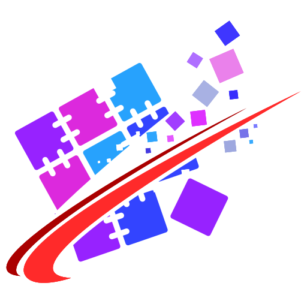

<p align="center"></p>

# HeadlessMc Quilt

A [HeadlessMc](https://github.com/headlesshq/headlessmc) plugin that adds the [Quilt](https://quiltmc.org) platform.

* `launch quilt/<mc-version>[/<loader-version>]` installs and launches Quilt clients,
  without a loader version the newest stable Quilt loader is used.
* `server add quilt/<mc-version>[/<loader-version>]` installs Quilt servers.
* Mods are read from `quilt.mod.json`, and from `fabric.mod.json`, because Quilt loads Fabric mods, too.

The client and server are installed with the official
[Quilt installer](https://github.com/QuiltMC/quilt-installer), which HeadlessMc downloads from the Quilt maven
and verifies against the hash pinned at build time (see `quiltInstaller` in [build.gradle](build.gradle)).
Loader versions come from [meta.quiltmc.org](https://meta.quiltmc.org/v3/versions/loader).

## Installation

```shell
headlessmc plugin download quilt
```

or download `headlessmc-quilt-<version>.jar` from the [releases](https://github.com/headlesshq/headlessmc-quilt/releases)
into the `plugins` directory in the HeadlessMc data directory, e.g. `~/.local/share/headlessmc/plugins`.
Check that it has been loaded with `headlessmc plugin ls`. Plugins need HeadlessMc 3.0.0-RC9 or newer.

## Building

```shell
git submodule update --init                # HeadlessMc and the Gradle plugin, not released yet
./gradlew build
./gradlew runQuilt                          # launches Quilt 1.21.4 with the plugin, -PminecraftVersion=...
./gradlew headlessmc --args="plugin ls"     # any HeadlessMc command, with the plugin installed
```

Releases are built by the [release workflow](.github/workflows/release.yml) when a GitHub release is published.

This project was created from the
[HeadlessMc plugin template](https://github.com/headlesshq/headlessmc-plugin-template)
and is packaged by the [HeadlessMc Gradle plugin](https://github.com/headlesshq/headlessmc-gradle-plugin).
The logo was made with [headlessmc-svg-mapping](https://github.com/headlesshq/headlessmc-svg-mapping)
from the [Quilt logo](https://github.com/QuiltMC/art).
